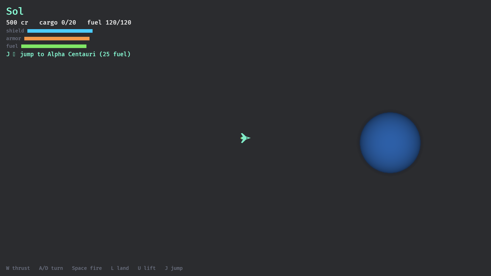
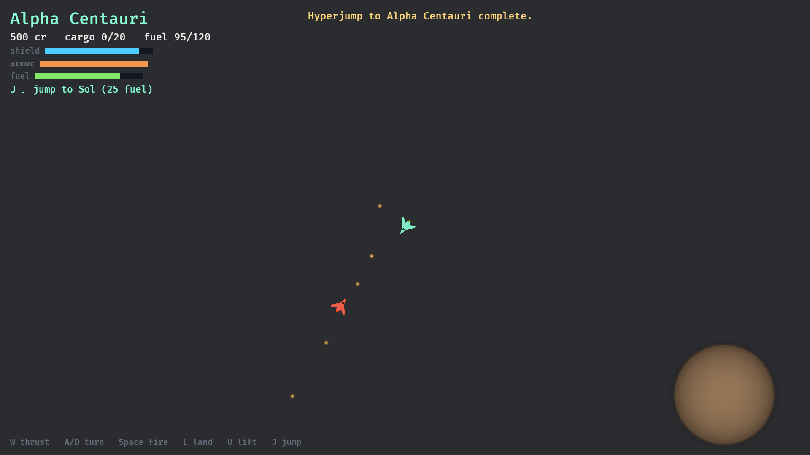
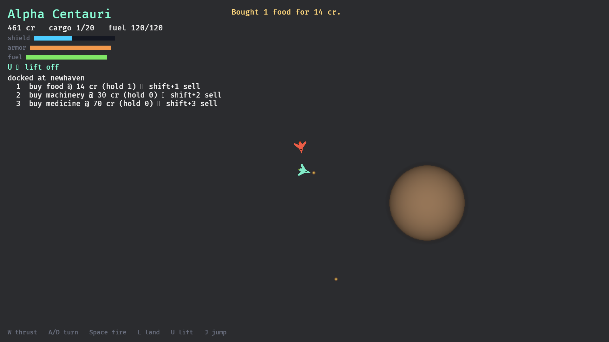

# Escape Velocity: The Return

A community-shard MMO inspired by Escape Velocity (1996): 2D top-down space
trading, missions, and combat in a shared, persistent galaxy. Rust + Bevy,
server-authoritative, playable offline single-player through an embedded
server.

## Quickstart

```bash
cargo run -p evr-server   # headless shard server (loads content/)
cargo run -p evr-client   # desktop client (needs a display)
cargo test --workspace    # unit + content pipeline tests
```

## Screenshots





Captured by the automated tour: `cargo run -p evr-client -- --capture-tour`
(F12 saves a screenshot anytime during play).

## Structure

| Path | What |
|---|---|
| `crates/` | evr-core (sim), evr-data (content), evr-protocol (wire), evr-server, evr-client, evr-mcp (MCP server) |
| `content/` | RON content packs — data, not code |
| `docs/gdd/` | game design (README is the index) |
| `docs/decisions/` | ADRs — the why behind everything |
| `docs/ideas/` | idea inbox, never deleted |
| `prompts/` | curated prompt library |
| `.opencode/skills/` | agent workflows |
| `ops/` | deployment (future) |

Agents: start at [AGENTS.md](AGENTS.md). Humans: start at
[docs/gdd/README.md](docs/gdd/README.md).

The game is also playable by agents: `evr-mcp` exposes the sim as an MCP
server (registered as `evr-game` in opencode.json) — observe, fly, trade,
fight, and hyperjump through tool calls. See `crates/mcp`.

## Milestones

- **M0** — workspace + content pipeline ✅
- **M1** — offline vertical slice: fly, trade, fight, hyperjump ✅
- **M2** — real networking: standalone server, 2+ players, govt-zone PvP
- **M3** — persistence: accounts, shared economy, multi-system shard
- **M4** — community playtest: faction meta-game, ops